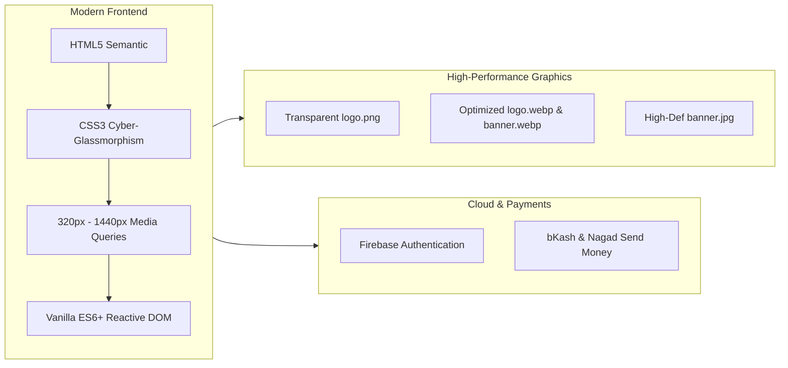

<div align="center">

  <br/>

  

  <br/><br/>

  # ⚡ Sonic’s E-Shop
  ### 🎮 Premier eFootball Coin Top-Up & Gaming Digital Marketplace
  **Ultra-Responsive • Cyber-Glassmorphism UI • Instant 1–10 Min Automated Delivery**

  <br/>

  <!-- Colorful Feature Badges -->
  <p align="center">
    <a href="https://github.com/saikat01733/Sonic-s-E-Shop"></a>
    <a href="https://github.com/saikat01733/Sonic-s-E-Shop"></a>
    <a href="https://github.com/saikat01733/Sonic-s-E-Shop"></a>
    <a href="https://github.com/saikat01733/Sonic-s-E-Shop"></a>
    <a href="https://github.com/saikat01733/Sonic-s-E-Shop"></a>
  </p>

  <p align="center">
    
    
    
    
    
    
  </p>

  <br/>

  <!-- Hero Banner Image -->
  <a href="https://github.com/saikat01733/Sonic-s-E-Shop">
    
  </a>

  <br/><br/>

  <!-- Quick Section Jump Links -->
  <p align="center">
    <b><a href="#-about-the-project">About</a></b> •
    <b><a href="#-key-features">Features</a></b> •
    <b><a href="#-responsive-design-matrix-320px---1440px">Responsiveness</a></b> •
    <b><a href="#-coin-packages--pricing">Packages</a></b> •
    <b><a href="#-payment-methods">Payment</a></b> •
    <b><a href="#-tech-stack">Tech Stack</a></b> •
    <b><a href="#-installation--usage">Quick Start</a></b> •
    <b><a href="#-customer-support">Support</a></b>
  </p>

</div>

---

## 🌟 About The Project

**Sonic’s E-Shop** is an ultra-modern, high-octane gaming top-up web application designed specifically for the eFootball gaming community in Bangladesh. Built with sleek **Cyber-Glassmorphism**, smooth tactile micro-animations, and full-spectrum responsive engineering, it gives gamers an unmatched, lightning-fast shopping experience across every device from a tiny **320px mobile screen** to a massive **1440px desktop display**.

> **Highlights:**
> - 💎 **Transparent Logo Branding**: Seamlessly integrates into the glowing top navigation bar without borders or background artifacts.
> - ⚡ **Fluid Scalability**: Zero horizontal scrollbar, intelligent flex/grid adaptations, and dynamic typography.
> - 🛡️ **Konami ID Safety First**: Safe top-up process ensuring 100% account security with zero ban risk.

---

## ✨ Key Features

<table>
  <tr>
    <td width="50%">
      <h3>🌓 Dual Cyber-Glass Theme Engine</h3>
      Toggle effortlessly between glowing <b>Cyber Dark</b> (deep space radial gradients with neon cyan/red accents) and <b>Frosted Light Glass</b> (crisp, elegant blur with rich contrast).
    </td>
    <td width="50%">
      <h3>📱 320px ⟷ 1440px Full Responsiveness</h3>
      Engineered with custom media queries and <code>clamp()</code> scaling. Logo, search bar, package cards, and banner adapt automatically with pixel-perfect precision on all viewports.
    </td>
  </tr>
  <tr>
    <td width="50%">
      <h3>🪙 Real-Time Multi-Package Cart</h3>
      Select multiple coin packages and legendary player bundle cards in one go! Real-time dynamic price tally (৳) with instant stock status badges (🟢 In Stock / 🔴 Out of Stock).
    </td>
    <td width="50%">
      <h3>🚚 Animated Interactive Delivery Truck</h3>
      Experience tactile checkout! Clicking <b>Buy Now</b> launches an animated 3D-styled delivery truck with active headlights driving across the road line before order completion.
    </td>
  </tr>
  <tr>
    <td width="50%">
      <h3>💳 1-Click Local Payment (bKash & Nagad)</h3>
      Includes interactive payment panels with copy-to-clipboard account numbers and 4-digit sender verification inputs for hassle-free bKash and Nagad transactions.
    </td>
    <td width="50%">
      <h3>🔐 Firebase Multi-Auth with Retro Lamp</h3>
      Interactive login experience: pull the retro lamp string to illuminate the stage! Supports <b>Google One-Tap OAuth</b>, <b>Email/Password</b>, and <b>Phone Number</b> registration.
    </td>
  </tr>
  <tr>
    <td width="50%">
      <h3>🧭 Floating Bottom Dock Navigation</h3>
      Quick-switch tabs in one touch with the iOS-inspired magnified bottom dock: <b>Home</b>, <b>My Wallet</b>, <b>Orders</b>, and <b>Redeem Codes</b>.
    </td>
    <td width="50%">
      <h3>💬 Multi-Channel Instant Support</h3>
      Floating action button triggering a modal with direct 1-click links for <b>WhatsApp</b>, <b>Telegram</b>, <b>Gmail Support</b>, and direct phone call assistance.
    </td>
  </tr>
</table>

---

## 📐 Responsive Design Matrix (320px - 1440px)

Every single element—including typography, icons, card grids, banner artwork, and header navigation—is calibrated across 5 distinct viewport tiers:

```
[320px Phone] ──> [480px Mobile] ──> [768px Tablet] ──> [1024px Laptop] ──> [1440px Desktop]
  28px Logo          34px Logo          40px Logo           44px Logo           48px Logo
  16:9 Banner        16:9 Banner        2.2:1 Banner        2.5:1 Banner        2.7:1 Banner
  2-Col Cards        2-Col Cards        3-Col Cards         4-Col Cards         4-Col Grid (Max)
```

| Viewport Tier | Target Devices | Logo Scaling | Hero Banner | Card Layout | Navigation Behavior |
|:---|:---|:---:|:---:|:---:|:---|
| **320px – 399px** | iPhone SE, Galaxy Fold (outer), Mini devices | `28px` height (max 110px) | `16 : 9` ratio, 14px radius | 2 columns (compact padding) | Compact search (115px), 48px toggle, 28px menu, **Zero overflow** |
| **400px – 599px** | iPhone 12/13/14/15/16, Galaxy S, Pixel | `34px` height (max 140px) | `16 : 9` ratio, 18px radius | 2 columns (standard) | Standard search box, fluid gaps |
| **600px – 767px** | Phablets, iPads (portrait), Small tablets | `36px` height (max 155px) | `1.9 : 1` widescreen | 3 columns grid | Container widens to `680px`, comfortable spacing |
| **768px – 1023px** | iPad Air, iPad Pro, Tablets (landscape) | `40px` height (max 170px) | `2.2 : 1` widescreen | 3 columns grid | Container expands to `780px`, 250px search bar |
| **1024px – 1440px+**| MacBooks, Laptops, 1080p & 1440p Monitors | `44px–48px` (max 210px) | `2.7 : 1` ultra-wide | 4 columns desktop grid | Container scales smoothly to `1100px`, centered dock |

---

## 🪙 Coin Packages & Live Pricing

| 🎮 Coin Package / Special Deals | 💰 Official Price | 📦 Current Status | ⚡ Delivery Speed |
|:---|:---:|:---:|:---:|
| **130 eFootball Coins** | ৳ 170 | `🟢 In Stock` | Instant (1-10 Min) |
| **260 eFootball Coins** | ৳ *** | `🔴 Out of Stock` | Restocking Soon |
| **300 eFootball Coins** | ৳ 350 | `🟢 In Stock` | Instant (1-10 Min) |
| **550 eFootball Coins** | ৳ 630 | `🟢 In Stock` | Instant (1-10 Min) |
| **750 eFootball Coins** | ৳ 840 | `🟢 In Stock` | Instant (1-10 Min) |
| **840 eFootball Coins** | ৳ *** | `🔴 Out of Stock` | Restocking Soon |
| **1040 eFootball Coins** | ৳ 1,170 | `🟢 In Stock` | Instant (1-10 Min) |
| **1630 eFootball Coins** | ৳ **** | `🔴 Out of Stock` | Restocking Soon |
| **2130 eFootball Coins** | ৳ 2,300 | `🟢 In Stock` | Instant (1-10 Min) |
| **3250 eFootball Coins** | ৳ 3,420 | `🟢 In Stock` | Instant (1-10 Min) |
| **5700 eFootball Coins** | ৳ 5,600 | `🟢 In Stock` | Instant (1-10 Min) |
| **12800 eFootball Coins** | ৳ 12,350 | `🟢 In Stock` | Instant (1-10 Min) |
| **⭐ 50 Coins + LUIS SUÁREZ** | ৳ 110 | `🟢 In Stock` | Special Deal 🔥 |
| **⭐ 100 Coins + IKER CASILLAS** | ৳ 300 | `🟢 In Stock` | Special Deal 🔥 |

---

## 💳 Payment Methods & Instructions

<div align="center">

|  |  |
|:---:|:---:|
| **Send Money Number:** `01733185830` | **Send Money Number:** `01733185830` |
| 1-Click Copy • Instant Validation | 1-Click Copy • Instant Validation |

</div>

### 📝 Step-by-Step Order Guide:
1. **Step 1:** Select your gaming device (`Android` or `iOS`) and enter your Konami Mail, Password, and WhatsApp Number.
2. **Step 2:** Click to choose your desired eFootball Coin package(s).
3. **Step 3:** Select your payment method (`bKash` or `Nagad`). Copy the number with one tap, send the exact total amount, and input your sender account's last 4 digits.
4. **Step 4:** Hit the **Buy Now** truck button to place your order!

---

## 🛠️ Tech Stack & Architecture



- **🎨 CSS Architecture**: Modular structure (`variables.css`, `main.css`, `responsive.css`), CSS Variables (`:root`), Backdrop-filter Blur, Custom Glass Shadows, Flexbox & CSS Grid.
- **⚡ JavaScript Logic**: Dynamic package calculation, search filter algorithm, theme toggle memory, animation state triggers.
- **🖼️ Image Optimization**: Dual WebP + PNG/JPEG fallback pipeline using `<picture>` elements for maximum speed and zero layout shift.

---

## 📂 Project Structure

```bash
Sonic-s-E-Shop/
├── index.html          # Main single-page application & interactive UI
├── css/
│   ├── variables.css   # Design tokens, color schemes & dark/light theme variables
│   ├── main.css        # Core layout, components, announcement ticker & badges
│   ├── responsive.css  # Dedicated 320px to 1440px+ device media queries
│   └── style.css       # Master modular stylesheet
├── style.css           # Production bundled stylesheet
├── logo.png            # Transparent brand logo (WebP/PNG)
├── logo.webp           # Optimized WebP logo asset
├── logo.jpg            # Standard JPEG logo
├── banner.jpg          # Official gaming hero banner (1024x439)
├── banner.webp         # Next-gen WebP responsive hero banner
└── README.md           # Documentation & repository overview
```

---

## 🚀 Installation & Usage

### 1. Clone the repository:
```bash
git clone git@github.com:saikat01733/Sonic-s-E-Shop.git
```

### 2. Enter project folder:
```bash
cd Sonic-s-E-Shop
```

### 3. Open in Browser:
You can simply double-click `index.html` to launch it in any modern web browser, or serve it using your preferred tool:

```bash
# Using Python 3:
python3 -m http.server 3000

# Using Node npx:
npx serve .
```

Visit `http://localhost:3000` to preview the shop live!

---

## 📞 Customer Support & Community

Need quick assistance, custom coin packages, or top-up confirmation? Reach out instantly:

<div align="center">

| Channel | Contact Info | Direct Action |
|:---|:---|:---:|
| **📱 WhatsApp** | `01733185830` | [Chat on WhatsApp](https://wa.me/8801733185830?text=I%20need%20support!) |
| **✈️ Telegram** | `01733185830` | [Message on Telegram](https://t.me/+8801733185830) |
| **✉️ Gmail** | `saikatahmmad701@gmail.com` | [Send an Email](mailto:saikatahmmad701@gmail.com) |
| **📞 Hotline** | `01733185830` | [Call Directly](tel:01733185830) |
| **🌐 Facebook** | Sonic's E-Shop Page | [Visit Official Page](https://www.facebook.com/share/166H5PHoS4W/) |
| **👥 Messenger** | Sonic Community Group | [Join Group Chat](https://m.me/j/AbY3MFES5LAMvV_Z/?send_source=gc%3Acopy_invite_link_t) |

</div>

---

<div align="center">
  <br/>
  <sub>⚡ Designed and engineered with passion for eFootball gamers. All product names, logos, and brands are property of their respective owners.</sub>
  <br/>
  <b>© 2026 Sonic’s E-Shop. All Rights Reserved.</b>
</div>
