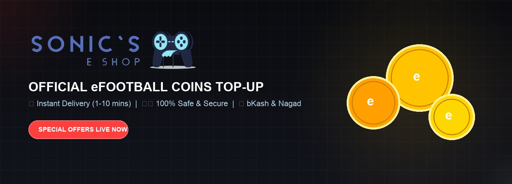
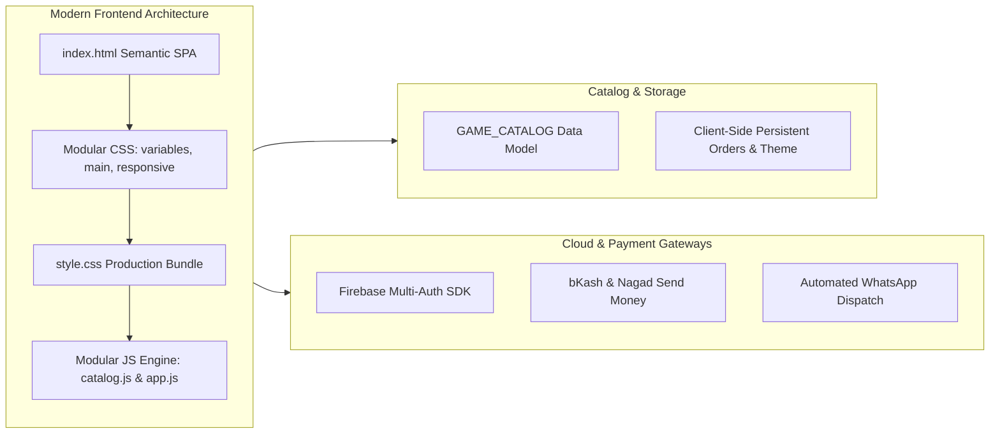

<div align="center">

  <br/>

  

  <br/><br/>

  # ⚡ Sonic’s E-Shop
  ### 🎮 Enterprise Multi-Game Top-Up & Digital Gaming Platform
  **Khela Store Architecture • eFootball, PUBG UC & Roblox Robux • 320px–1440px Responsive**

  <br/>

  <!-- Colorful Feature Badges -->
  <p align="center">
    <a href="https://github.com/saikat01733/Sonic-s-E-Shop"></a>
    <a href="https://github.com/saikat01733/Sonic-s-E-Shop"></a>
    <a href="https://github.com/saikat01733/Sonic-s-E-Shop"></a>
    <a href="https://github.com/saikat01733/Sonic-s-E-Shop"></a>
    <a href="https://github.com/saikat01733/Sonic-s-E-Shop"></a>
    <a href="https://github.com/saikat01733/Sonic-s-E-Shop"></a>
  </p>

  <p align="center">
    
    
    
    
    
    
  </p>

  <br/>

  <!-- Hero Banner Image -->
  <a href="https://github.com/saikat01733/Sonic-s-E-Shop">
    
  </a>

  <br/><br/>

  <!-- Quick Section Jump Links -->
  <p align="center">
    <b><a href="#-about-the-project">About</a></b> •
    <b><a href="#-key-features">Features</a></b> •
    <b><a href="#-supported-games--catalog">Games Catalog</a></b> •
    <b><a href="#-responsive-design-matrix-320px---1440px">Responsiveness</a></b> •
    <b><a href="#-payment-methods">Payment</a></b> •
    <b><a href="#-tech-stack--architecture">Tech Stack</a></b> •
    <b><a href="#-installation--usage">Quick Start</a></b> •
    <b><a href="#-customer-support">Support</a></b>
  </p>

</div>

---

## 🌟 About The Project

**Sonic’s E-Shop** is an enterprise-grade multi-game top-up platform engineered after Bangladesh's leading gaming store models (inspired by **Khela Store**). Built with sleek **Cyber-Glassmorphism**, modular architecture, and full-spectrum responsive engineering, it gives gamers an unmatched, lightning-fast shopping experience across every device from a tiny **320px mobile phone** to a massive **1440px desktop monitor**.

> **Highlights:**
> - 🎮 **Multi-Game Hub**: eFootball™ Coins, PUBG Mobile UC, and Roblox Robux matching the official hero banner.
> - ⚡ **Smart Product Type Engine**: Automatically switches between **UID Direct Top-Up** (no password required) and **Login Purchase** (Konami ID/Pass) based on game specification.
> - 🧾 **Instant Digital Invoice**: Generates printable receipts with Order ID, detailed breakdown, and 1-click WhatsApp support links.
> - 🔍 **Live Order Tracking**: Search orders anytime using Order ID or WhatsApp number.
> - 💎 **Transparent Logo & Aspect-Ratio Banner**: Crystal-clear branding without solid container boxes across 320px to 1440px.

---

## ✨ Key Features

<table>
  <tr>
    <td width="50%">
      <h3>🎮 Khela Store Multi-Game Catalog</h3>
      Filter by category (All, eFootball, PUBG Mobile, Roblox) with interactive pills, real-time stock indicators, and custom delivery tags.
    </td>
    <td width="50%">
      <h3>🌓 Dual Cyber-Glass Theme Engine</h3>
      Toggle effortlessly between glowing <b>Cyber Dark</b> (deep space radial gradients with neon cyan/red accents) and <b>Frosted Light Glass</b> (crisp, elegant blur with rich contrast).
    </td>
  </tr>
  <tr>
    <td width="50%">
      <h3>⚙️ Dynamic Step 1 Form Adapter</h3>
      Adapts automatically to the selected game: renders Android/iOS device selector & Konami login for eFootball; renders UID & Character Name for PUBG; renders Username for Roblox.
    </td>
    <td width="50%">
      <h3>🪙 Real-Time Multi-Package Cart</h3>
      Select multiple coin, UC, diamond, or Robux packages in one go! Real-time dynamic price tally (৳) with instant stock badges (🟢 In Stock / 🔴 Out of Stock).
    </td>
  </tr>
  <tr>
    <td width="50%">
      <h3>🎟️ Promo & Coupon Engine</h3>
      Integrated discount vouchers (<code>SONIC10</code>, <code>EFOOTBALL</code>, <code>KHELA</code>) with 1-click copy-paste and real-time total price deductions.
    </td>
    <td width="50%">
      <h3>🚚 Animated Interactive Delivery Truck</h3>
      Experience tactile checkout! Clicking <b>Order Confirm</b> launches an animated 3D-styled delivery truck driving across the road line before order completion.
    </td>
  </tr>
  <tr>
    <td width="50%">
      <h3>💳 1-Click Local Payment (bKash & Nagad)</h3>
      Interactive payment panels with 1-click copy account number (<code>01733185830</code>) and 4-digit sender verification inputs for seamless transactions.
    </td>
    <td width="50%">
      <h3>🧾 Digital Invoices & Live Tracking</h3>
      Full offline-persistent order history in <b>My Orders</b> tab with searchable Order ID lookup and printable digital receipt modal.
    </td>
  </tr>
</table>

---

## 🎮 Supported Games & Top-Up Catalog

| Game Title | Product Type | Required Info | Packages Available | Delivery Speed |
|:---|:---:|:---:|:---:|:---:|
| ⚽ **eFootball™ 2026** | `Login Purchase` | Device (Android/iOS), Konami Mail & Password | 130 to 12,800 Coins + Player Packs | ⚡ 1–10 Minutes |
| 🔫 **PUBG Mobile** | `In-Game ID (UID)` | Player ID (UID), Character Name (Optional) | 60 to 8,100 UC | ⚡ 1–5 Minutes |
| 🧱 **Roblox** | `Username ID` | Roblox Username | 80 to 4,500 Robux | ⚡ 5–15 Minutes |

---

## 📐 Responsive Design Matrix (320px - 1440px)

Every single element—typography, icons, catalog cards, package grids, banner artwork, and header navigation—is calibrated across 5 distinct viewport tiers:

```
[320px Phone] ──> [480px Mobile] ──> [768px Tablet] ──> [1024px Laptop] ──> [1440px Desktop]
  28px Logo          34px Logo          40px Logo           44px Logo           48px Logo
  2-Col Catalog      2-Col Catalog      3-Col Catalog       4-Col Catalog       4-Col Grid (Max)
  2-Col Packages     2-Col Packages     3-Col Packages      4-Col Packages      4-Col Grid (Max)
```

| Viewport Tier | Target Devices | Logo Scaling | Hero Banner | Grid Layout | Navigation Behavior |
|:---|:---|:---:|:---:|:---:|:---|
| **320px – 399px** | iPhone SE, Galaxy Fold, Mini phones | `28px` height (max 110px) | `1024:439` native ratio | 2 columns (compact padding) | Compact search (115px), 48px toggle, 28px menu, **Zero overflow** |
| **400px – 599px** | iPhone 12/13/14/15/16, Galaxy S, Pixel | `34px` height (max 140px) | `1024:439` native ratio | 2 columns (standard) | Standard search box, fluid gaps |
| **600px – 767px** | Phablets, iPads (portrait), Small tablets | `36px` height (max 155px) | `1024:439` widescreen | 3 columns grid | Container widens to `680px`, comfortable spacing |
| **768px – 1023px** | iPad Air, iPad Pro, Tablets (landscape) | `40px` height (max 170px) | `1024:439` widescreen | 3 columns grid | Container expands to `780px`, 250px search bar |
| **1024px – 1440px+**| MacBooks, Laptops, 1080p & 1440p Monitors | `44px–48px` (max 210px) | `1024:439` ultra-wide | 4 columns desktop grid | Container scales smoothly to `1100px`, centered dock |

---

## 💳 Payment Methods & Instructions

<div align="center">

|  |  |
|:---:|:---:|
| **Send Money Number:** `01733185830` | **Send Money Number:** `01733185830` |
| 1-Click Copy • Instant Validation | 1-Click Copy • Instant Validation |

</div>

### 📝 Step-by-Step Order Guide:
1. **Step 1:** Click on your desired game from the **Gaming Top-Up Catalog** (eFootball, PUBG Mobile, or Roblox).
2. **Step 2:** Fill in your required account information (UID or Konami login) and WhatsApp number.
3. **Step 3:** Select your desired package(s) and apply any promo code (e.g. `SONIC10`).
4. **Step 4:** Select payment method (`bKash` or `Nagad`), copy number, send payment, and enter your last 4 digits.
5. **Step 5:** Click **অর্ডার কনফার্ম করুন**! The animated delivery truck dispatches, your digital invoice pops up, and order details are sent to WhatsApp.

---

## 🛠️ Tech Stack & Architecture



- **🎨 CSS Architecture**: Modular files (`variables.css`, `main.css`, `responsive.css`), CSS Variables (`:root`), Backdrop-filter Blur, Custom Glass Shadows, Flexbox & CSS Grid.
- **⚡ JavaScript Logic**: Reactive game catalog rendering, dynamic form field generation, multi-package cart calculation, coupon validation, live order search, printable receipts.
- **🖼️ Image Optimization**: WebP + PNG/JPEG fallback pipeline using `<picture>` elements for zero layout shift.

---

## 📂 Project Structure

```bash
Sonic-s-E-Shop/
├── index.html          # Main single-page application & interactive UI
├── css/
│   ├── variables.css   # Design tokens, color schemes & dark/light theme variables
│   ├── main.css        # Core layout, catalog grid, receipt modal & badges
│   ├── responsive.css  # Dedicated 320px to 1440px+ device media queries
│   └── style.css       # Master modular stylesheet with @import
├── js/
│   ├── catalog.js      # Multi-game catalog data model (eFootball, PUBG, Roblox, FF)
│   └── app.js          # Core application engine, order tracker & dynamic UI
├── assets/
│   ├── efootball.jpg   # eFootball poster graphic
│   ├── pubg.jpg        # PUBG Mobile poster graphic
│   └── roblox.jpg      # Roblox Robux poster graphic
├── style.css           # Production bundled stylesheet
├── logo.png            # Transparent brand logo (WebP/PNG)
├── logo.webp           # Optimized WebP logo asset
├── logo.jpg            # Standard JPEG logo
├── banner.jpg          # Official gaming hero banner (1024x439)
├── banner.webp         # Next-gen WebP responsive hero banner
└── README.md           # Documentation & repository overview
```

---

## 🚀 Installation & Usage

### 1. Clone the repository:
```bash
git clone git@github.com:saikat01733/Sonic-s-E-Shop.git
```

### 2. Enter project folder:
```bash
cd Sonic-s-E-Shop
```

### 3. Open in Browser:
```bash
# Using Python 3:
python3 -m http.server 3000

# Using Node npx:
npx serve .
```

Visit `http://localhost:3000` to preview the shop live!

---

## 📞 Customer Support & Community

<div align="center">

| Channel | Contact Info | Direct Action |
|:---|:---|:---:|
| **📱 WhatsApp** | `01733185830` | [Chat on WhatsApp](https://wa.me/8801733185830?text=I%20need%20support!) |
| **✈️ Telegram** | `01733185830` | [Message on Telegram](https://t.me/+8801733185830) |
| **✉️ Gmail** | `saikatahmmad701@gmail.com` | [Send an Email](mailto:saikatahmmad701@gmail.com) |
| **📞 Hotline** | `01733185830` | [Call Directly](tel:01733185830) |
| **🌐 Facebook** | Sonic's E-Shop Page | [Visit Official Page](https://www.facebook.com/share/166H5PHoS4W/) |
| **👥 Messenger** | Sonic Community Group | [Join Group Chat](https://m.me/j/AbY3MFES5LAMvV_Z/?send_source=gc%3Acopy_invite_link_t) |

</div>

---

<div align="center">
  <br/>
  <sub>⚡ Designed and engineered with passion for gamers. All product names, logos, and brands are property of their respective owners.</sub>
  <br/>
  <b>© 2026 Sonic’s E-Shop. All Rights Reserved.</b>
</div>
